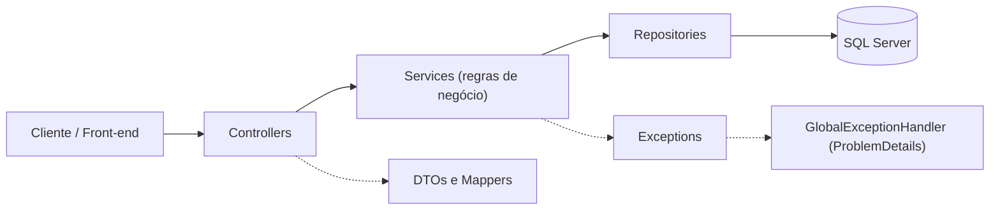

# LibCore

[](https://github.com/LeonardoIafrate/Livraria/actions/workflows/ci.yml)

API REST em ASP.NET Core para gerenciar usuários, livros e pedidos de uma livraria. O objetivo do projeto é aplicar conceitos de desenvolvimento back-end: arquitetura em camadas, persistência de dados, autenticação, migrations e testes automatizados.

## Tecnologias

- C# e .NET 10 (ASP.NET Core Web API)
- Entity Framework Core e SQL Server
- Autenticação JWT
- Swagger / OpenAPI
- xUnit, NSubstitute e Testcontainers (testes com SQL Server real)
- Docker e Docker Compose
- Git e GitHub Actions
- React, TypeScript e Vite (front-end)

## Funcionalidades

- ✅ Cadastro e gerenciamento de usuários e endereços
- ✅ Autenticação com JWT e controle de permissões por perfil (Admin e Cliente)
- ✅ Livros, autores, categorias, editoras e estoque
- ✅ Pedidos com cálculo de total no servidor, controle de estoque e fluxo de status
- ✅ Paginação e filtros nas listagens de livros, pedidos e usuários
- ✅ Validação de dados e respostas de erro padronizadas (ProblemDetails)
- ✅ Bloqueio de login após tentativas incorretas e limite de requisições por IP
- ✅ Invalidação imediata do acesso de usuários desativados
- ✅ CORS configurável por ambiente
- ✅ Health checks (`/health/live` e `/health/ready`)
- ✅ Testes unitários e de integração executados no GitHub Actions
- ✅ Front-end em React consumindo a API (catálogo, carrinho, pedidos e painel de administração)
- ✅ Capas dos livros enviadas pelo painel de administração

## Arquitetura

O projeto usa arquitetura em camadas para separar as responsabilidades:



| Pasta | Responsabilidade |
|---|---|
| `Controllers` | Rotas HTTP, autorização e conversão de entrada e saída |
| `Services` | Regras de negócio |
| `Repository` / `Interfaces` | Acesso a dados com EF Core |
| `Models` / `Dtos` / `Mappers` | Entidades, contratos da API e conversões |
| `Exceptions` | Exceções de negócio convertidas em respostas HTTP |
| `Data` | `DbContext`, migrations e dados iniciais |

## Como executar

### Com Docker Compose

```bash
cp .env.example .env      # preencha os valores
docker compose up --build
```

- Loja (front-end): http://localhost:5173
- Swagger: http://localhost:8080/swagger
- Health check: http://localhost:8080/health/ready

Na primeira execução a API aplica as migrations, cria o administrador definido no `.env` (`BOOTSTRAP_ADMIN_*`) e cadastra um catálogo de exemplo.

### Sem Docker (apenas a API)

```bash
cd api
dotnet user-secrets set "Jwt:Chave" "uma-chave-com-pelo-menos-32-caracteres"
dotnet user-secrets set "ConnectionStrings:DefaultConnection" "<sua connection string>"
dotnet run
```

### Front-end (React)

O `docker compose up --build` já sobe o front-end junto (http://localhost:5173). Para desenvolver com recarga automática, rode-o à parte com a API em execução:

```bash
cd frontend
cp .env.example .env      # no PowerShell: copy .env.example .env
npm install
npm run dev
```

- Acesse http://localhost:5173. Em Development a API só libera CORS para as portas 5173 e 3000 (`Cors:Origens`).
- No `.env` do front-end, `VITE_API_URL` aponta para a API: `http://localhost:8080` (Docker Compose) ou `http://localhost:5279` (`dotnet run`).
- Para entrar no painel de administração (`/admin`), use o administrador definido em `BOOTSTRAP_ADMIN_*` no `.env` da API.
- As capas enviadas ficam no volume `uploads_data` do Docker Compose (ou em `api/wwwroot/uploads` sem Docker).
- O Vite não funciona se o caminho do projeto tiver `#` (por exemplo uma pasta `C#`). Mantenha o projeto em um caminho sem esse caractere.

## Testes

```bash
dotnet test
```

Os testes de integração e de banco usam Testcontainers, então o **Docker precisa estar em execução**. A suíte cobre:

- **Regras de negócio:** serviços com repositórios simulados (NSubstitute).
- **API completa:** autenticação, permissões, validações e fluxo de pedidos, usando um SQL Server real em container.
- **Banco de dados:** índices únicos, check constraints, comportamento de exclusão, concorrência de estoque e migrations sem pendências.
- **Segurança:** bloqueio de login, limite de requisições, isolamento entre usuários e token de usuário desativado.

## Endpoints principais

| Recurso | Rotas | Acesso |
|---|---|---|
| Autenticação | `POST /api/auth/login` | Público |
| Usuários | `POST /api/usuarios` | Público |
| | `GET/PUT /api/usuarios/me`, `PUT /api/usuarios/me/senha`, `PATCH /api/usuarios/me/desativar` | Autenticado |
| | `GET /api/usuarios`, `GET /api/usuarios/{id}`, `POST /api/usuarios/admin` e demais | Admin |
| Endereços | `/api/enderecos` (CRUD e endereço principal) | Autenticado (apenas do próprio usuário) |
| Livros, autores, categorias e editoras | `GET` | Público |
| | `POST`, `PUT`, `DELETE` | Admin |
| Capa do livro | `PUT /api/livros/{id}/imagem` (multipart, campo `arquivo`; JPEG, PNG ou WebP até 2 MB), `DELETE /api/livros/{id}/imagem` | Admin |
| | `GET /uploads/livros/{arquivo}` | Público |
| Estoque | `/api/estoques` | Admin |
| Pedidos | `POST /api/pedidos`, `GET /api/pedidos/meus-pedidos`, `GET /api/pedidos/{id}`, `PATCH .../cancelar`, `PATCH .../endereco` | Autenticado |
| | `GET /api/pedidos`, `PATCH /api/pedidos/{id}/status` | Admin |

Listagens paginadas aceitam `?pagina=1&tamanhoPagina=10` (máximo de 50 por página).

## Decisões de projeto

- **Preço e total no servidor:** o cliente informa livro e quantidade; o valor vem do banco.
- **Estoque protegido contra concorrência:** `RowVersion` no estoque e check constraint impedem vender mais do que existe, mesmo com compras simultâneas.
- **Endereço do pedido é uma cópia:** alterar ou excluir o endereço do usuário não muda pedidos já feitos.
- **Um endereço principal por usuário:** garantido por índice único filtrado no banco.
- **Login seguro:** senhas com hash, mensagem única para credenciais inválidas (sem revelar se o e-mail existe), bloqueio de 15 minutos após 5 falhas e limite de requisições por IP na rota de login.
- **Tokens de usuários desativados deixam de valer na hora:** o status do usuário é conferido a cada requisição autenticada, ao custo de uma consulta leve.
- **Listas pequenas sem paginação:** autores, categorias e editoras são catálogos curtos, usados em listas de seleção.

## Próximos passos

- Refresh token
- Paginação em mais listagens, se o volume de dados justificar